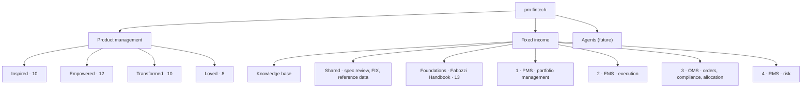
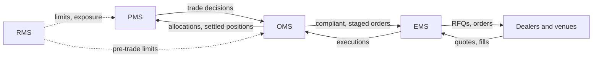

# pm-fintech

Claude skills for two domains:

- **Product management**: the four SVPG books (*Inspired*, *Empowered*, *Transformed*, *Loved*).
- **Fixed income trading systems**: from instrument knowledge through portfolio management, execution, order management, allocation and risk. Priority order: **PMS → EMS → OMS → RMS**.

Skills hold the knowledge and procedures. Agents, planned later, chain skills and tools into roles (see [Agents](#agents-future)).

The skills were written from knowledge of the books and from public standards, not from the books' text. Each book folder has a `VERIFY.md` listing every claim attributed to the book, with a confidence level and where to check it.

## Status

Each skill moves through four stages. Only **Committed** means the files are in this repository.

| Status | Meaning |
|---|---|
| **Committed** | `SKILL.md` and its files are on `main` in this repo. |
| **Built, not committed** | Built and tested in a working session and delivered as `.skill` or `.zip` files. Not in this repo yet. |
| **Planned** | Scoped in an earlier plan, not built. |
| **Proposed** | New in this roadmap. Scope to confirm before building. |

A skill is marked Committed only when its folder is on `main`, not when it is built.

| Branch | Committed | Built, not committed | Planned | Proposed |
|---|---|---|---|---|
| Product management | 0 | 40 | 0 | 0 |
| Fixed income: foundations and shared | 0 | 15 | 1 | 2 |
| Fixed income: PMS | 0 | 0 | 0 | 5 |
| Fixed income: EMS | 0 | 2 | 4 | 3 |
| Fixed income: OMS | 0 | 1 | 0 | 3 |
| Fixed income: RMS | 0 | 0 | 0 | 4 |
| Fixed income: cross-system review | 0 | 0 | 1 | 0 |
| **Total** | **0** | **58** | **6** | **17** |

**In the repo now:** this README, `inspired/VERIFY.md` and `transformed/VERIFY.md`. No skills yet.

**Not in the repo yet:** the fixed income knowledge base (built, not committed) and the `VERIFY.md` files for Empowered, Fabozzi and Loved.

## Skills tree



How the four systems connect in a trade's life. The build priority (PMS, EMS, OMS, RMS) differs from the flow order.



---

## Product management

### Inspired — Marty Cagan, *Inspired* (2nd ed., 2017) · `inspired/`

| Skill | Job | Status |
|---|---|---|
| `inspired-four-risks` | Score value, usability, feasibility and viability risk; pick what to test first | Built, not committed |
| `inspired-discovery-framing` | Opportunity assessment, customer letter or startup canvas, by size of effort | Built, not committed |
| `inspired-discovery-planning` | Story map; customer discovery program (about six reference customers) | Built, not committed |
| `inspired-customer-interviews` | Interview guide and synthesis; concierge tests, customer misbehavior, hack days | Built, not committed |
| `inspired-prototype-design` | Choose and spec the prototype: feasibility, user, live-data, Wizard of Oz | Built, not committed |
| `inspired-discovery-testing` | Usability, value, demand and feasibility tests with criteria set in advance | Built, not committed |
| `inspired-stakeholders-viability` | Stakeholder constraints by function; one-on-one prototype previews | Built, not committed |
| `inspired-outcome-roadmap` | Convert feature roadmaps into problems, outcomes and high-integrity commitments | Built, not committed |
| `inspired-vision-principles` | Product vision, product strategy (market sequencing), product principles | Built, not committed |
| `inspired-team-diagnostic` | Score a team against the failed-effort pattern and strong-team principles | Built, not committed |

### Empowered — Marty Cagan with Chris Jones, *Empowered* (2020) · `empowered/`

| Skill | Job | Status |
|---|---|---|
| `strategic-context` | Mission, scorecard, company objectives, vision and strategy as inputs for teams | Built, not committed |
| `product-strategy` | Focus, insights, action, management; produces the problems to assign | Built, not committed |
| `team-objectives` | Assign problems to teams; ambition levels; high-integrity commitments | Built, not committed |
| `empowered-team-check` | Empowered team vs feature team gap analysis | Built, not committed |
| `product-vision-principles` | Draft or critique a vision and product principles | Built, not committed |
| `team-topology` | Platform vs experience teams; ownership, autonomy, alignment | Built, not committed |
| `stakeholder-collaboration` | Collaboration over stakeholder management; evangelism | Built, not committed |
| `decisions-and-meetings` | Decision sizing, disagree and commit, meeting design | Built, not committed |
| `pm-coaching-assessment` | Assess a PM and build a coaching plan | Built, not committed |
| `one-on-one-and-narrative` | Coaching one-on-ones; reviewing written narratives | Built, not committed |
| `product-hiring` | Competence and character; interview loops; remote hires | Built, not committed |
| `people-lifecycle` | Onboarding, bootcamp, reviews, terminating, promoting | Built, not committed |

### Transformed — Marty Cagan et al., *Transformed* (2024) · `transformed/`

| Skill | Job | Status |
|---|---|---|
| `transformed-model-core` | Shared vocabulary: three dimensions of change, five concepts; routes to the others | Built, not committed |
| `transformed-assessment` | Score an org against the product model; rank the top three gaps | Built, not committed |
| `transformed-team-topology` | Review team structure; flag renamed-but-unchanged teams | Built, not committed |
| `transformed-strategy-review` | Test vision, strategy, roadmaps and objectives for outcome focus | Built, not committed |
| `transformed-discovery-check` | Check discovery practice against the four risks | Built, not committed |
| `transformed-delivery-check` | Release frequency, instrumentation, monitoring, deployment; gaps by severity | Built, not committed |
| `transformed-role-competencies` | Evaluate PM, designer, tech lead and product leader competencies | Built, not committed |
| `transformed-plan` | Scope, sequence and phase a transformation | Built, not committed |
| `transformed-objections` | Prepare responses to objections by who raises them | Built, not committed |
| `transformed-evangelism` | Draft transformation communications | Built, not committed |

### Loved — Martina Lauchengco, *Loved* (SVPG series, 2022) · `loved/`

| Skill | Job | Status |
|---|---|---|
| `pmm-market-insight` | Customer and market insight as the base for marketing decisions | Built, not committed |
| `pmm-positioning` | Positioning: market, audience, differentiation | Built, not committed |
| `pmm-messaging` | Messaging built on the positioning | Built, not committed |
| `pmm-asset-review` | Review marketing assets against positioning and messaging | Built, not committed |
| `pmm-gtm-strategy` | Go-to-market strategy, B2B and B2C | Built, not committed |
| `pmm-launch` | Launch planning, including solo-founder and small-team paths | Built, not committed |
| `pmm-sales-enablement` | Sales enablement material and process | Built, not committed |
| `pmm-org` | Product marketing team structure and role | Built, not committed |

---

## Fixed income

### Knowledge base · `fixed-income/kb/` · Built, not committed

The source of truth the skills are generated from: instrument ontology, conventions registry, calculator libraries, FIX dictionaries, workflow state machines and the test suites (each calculator cross-checked against QuantLib, published CME/SIFMA/Treasury values or closed-form results).

### Shared · `fixed-income/shared/`

| Skill | Covers | Status |
|---|---|---|
| `fi-spec-review` | Check a product spec for wrong terminology, missing conventions, undefined calculations and missing edge cases; write QA cases | Built, not committed |
| `fix-protocol-core` | FIX message structure, session layer, rejects, version differences, fixed income fields; parser, builder and validator | Built, not committed |
| `fi-router` | Classify a request and send it to the right skill | Planned |
| `fi-security-master` | Static data model per instrument: identifiers, schedules, call and sink features, factor updates, data quality checks | Proposed |
| `fi-market-data` | Price sources (evaluated, composite, executable), curve inputs, stale and outlier price checks | Proposed |

### Foundations — Fabozzi, *The Handbook of Fixed Income Securities* (9th ed.) · `fixed-income/foundations/`

| Skill | Covers | Status |
|---|---|---|
| `fi-foundations` | Instrument features, risks, structure of rates | Built, not committed |
| `analytics-core` | Price, yield, accrued interest, total return, duration, convexity; the shared calculation library | Built, not committed |
| `govies-and-money-markets` | Treasuries, agencies, commercial paper, floaters, inflation-linked bonds, non-US sovereigns | Built, not committed |
| `credit-instruments` | Corporates, munis, leveraged loans, structured notes and CLNs, emerging markets, preferreds | Built, not committed |
| `trading-and-financing` | Bond market structure, ETFs, repo and financing | Built, not committed |
| `yield-curve` | Forwards, curve trades, curve dynamics, no-arbitrage models | Built, not committed |
| `valuation-and-rv` | Relative value, embedded options and OAS, convertibles | Built, not committed |
| `credit-analysis` | Corporate and muni credit, Merton model, transition matrices, DTS | Built, not committed |
| `securitized` | Agency MBS, CMOs, RMBS, CMBS, ABS, CLOs, prepayment models | Built, not committed |
| `rates-derivatives` | Futures, swaps, swaptions, caps and floors | Built, not committed |
| `credit-derivatives` | CDS pricing and the standard model | Built, not committed |
| `portfolio-construction` | Indexes, benchmarked portfolios, factor risk, cash-flow matching | Built, not committed |
| `performance-attribution` | Returns and attribution | Built, not committed |

### 1 · PMS — portfolio management · `fixed-income/pms/`

Where investment decisions are made. Builds on `analytics-core`, `portfolio-construction` and `performance-attribution`.

| Skill | Covers | Status |
|---|---|---|
| `pms-positions-and-cash` | Positions and lots, traded vs settled, accruals, coupons, paydowns, cash projection | Proposed |
| `pms-exposure-analytics` | Portfolio vs benchmark: duration, key-rate duration, DTS, sector, rating and maturity buckets, active weights | Proposed |
| `pms-pnl-explain` | Daily P&L split into carry and roll, curve, spread, trading and residual | Proposed |
| `pms-what-if-rebalance` | Proposed trades, what-if impact, rebalance to targets or a model portfolio, cash raise and invest, consistency across accounts | Proposed |
| `pms-order-generation` | Turn decisions into orders: sizing to minimum piece and increment, account split, instructions, handoff to OMS | Proposed |

### 2 · EMS — execution · `fixed-income/ems/`

Getting the trade done. The Planned skills draw on Harris (*Trading and Exchanges*), Lehalle & Laruelle (*Market Microstructure in Practice*) and Cartea, Jaimungal & Penalva (*Algorithmic and High-Frequency Trading*).

| Skill | Covers | Status |
|---|---|---|
| `otc-negotiation` | RFQ one-to-one and one-to-many, list RFQ, portfolio trades; state machines and FIX flows | Built, not committed |
| `otc-pricing` | Indicative, firm and subject quotes; price, yield and spread quoting; spotting | Built, not committed |
| `liquidity-and-costs` | Liquidity measures, cost models, pre-trade cost estimates | Planned |
| `tca-best-execution` | Post-trade TCA, benchmarks, best execution evidence | Planned |
| `optimal-execution` | Order slicing and scheduling under cost and risk | Planned |
| `market-making` | Dealer-side quoting, inventory and adverse selection | Planned |
| `ems-protocol-selection` | Choosing RFQ, all-to-all, portfolio trade, session or voice by size and liquidity | Proposed |
| `ems-dealer-selection` | Counterparty lists, hit and cover rates, information leakage, dealer scoring | Proposed |
| `ems-portfolio-trading` | Building a portfolio trade, link to ETF creation and redemption, line-level price checks | Proposed |

### 3 · OMS — orders, compliance, allocation · `fixed-income/oms/`

The order record from decision to settlement.

| Skill | Covers | Status |
|---|---|---|
| `otc-order-staging` | OMS-to-EMS staging, care orders, parent and child orders, cancel and replace, fills; order state machine | Built, not committed |
| `oms-pre-trade-compliance` | Investment guidelines, restricted lists, issuer and concentration limits, rating floors, hard vs soft breaches, overrides | Proposed |
| `oms-allocations` | Pre- and post-trade allocation, pro-rata partial fills, minimum piece and increment rounding, average price, FIX allocation messages | Proposed |
| `oms-post-trade` | Confirmation and affirmation, settlement instructions, settlement cycles and fails, regulatory trade reporting | Proposed |

`oms-allocations` overlaps the allocation part of `otc-order-staging`. Decide the split before building.

### 4 · RMS — risk · `fixed-income/rms/`

Monitoring across all systems. Builds on `analytics-core`, `credit-analysis` and `credit-derivatives`.

| Skill | Covers | Status |
|---|---|---|
| `rms-market-risk` | VaR and expected shortfall, historical and hypothetical stress, key-rate and spread shocks | Proposed |
| `rms-limits` | Limit framework, pre- and post-trade checks, breach escalation | Proposed |
| `rms-credit-counterparty` | Issuer concentration, counterparty exposure, settlement risk, collateral | Proposed |
| `rms-liquidity-risk` | Position liquidity, time to liquidate, fund liquidity buckets | Proposed |

### Cross-system review

| Skill | Covers | Status |
|---|---|---|
| `oems-readiness-review` | Review an OEMS against the skills above: coverage, conventions, workflows, gaps | Planned |

---

## Build order

1. **Commit what is built but not committed:** the four product sets, the 18 fixed income skills and the knowledge base.
2. **Reference data:** `fi-security-master`, `fi-market-data`. PMS depends on them.
3. **PMS:** the five proposed skills.
4. **EMS:** `liquidity-and-costs` and `tca-best-execution`, then the proposed EMS skills, then `optimal-execution` and `market-making`.
5. **OMS:** pre-trade compliance, allocations, post-trade.
6. **RMS:** limits first, then market, credit and liquidity risk.
7. **Cross-system:** `fi-router`, `oems-readiness-review`.

**Inclusion rule.** Each skill is evaluated against the base model on cases built around what it encodes: house conventions, edge cases, recent market facts, multi-step reconciliations. A skill that ties is dropped and its facts stay in the knowledge base. The last fixed income evaluation was a tie (44/45 with and without skills) because its cases were textbook calculations; a harder set is pending.

---

## Agents (future)

An agent is a role that chains skills and tools (MCP servers, simulators, data sources) toward an outcome, with set permissions and human checkpoints. Skills stay the knowledge; agents add orchestration, tools and decisions. Definitions will live in `agents/<name>.md` (Claude Code subagent format) or be built on the Claude Agent SDK.

**Guardrails for every agent**

- Read-only by default.
- Nothing sends an order, RFQ, allocation or message to a client or dealer without human approval.
- Every action is logged.
- Each agent has its own evaluation set, run before it is used.

### Product agents

| Agent | Does | Skills |
|---|---|---|
| `discovery-agent` | Idea → four risks → framing → test plan → readout | `inspired-*` |
| `transformation-coach` | Assessment → plan → objection prep → communications | `transformed-*`, `empowered-team-check` |
| `pm-coach` | Coaching assessment, one-on-one prep, narrative review | `pm-coaching-assessment`, `one-on-one-and-narrative`, `people-lifecycle` |
| `launch-agent` | Market insight → positioning → messaging → launch plan | `pmm-*` |

### Fixed income agents

| Agent | Does | Skills and tools |
|---|---|---|
| `fix-agent` | Operates a FIX simulator: builds and sends messages, validates responses, replays logs, runs negotiation test scripts | `fix-protocol-core`, `otc-negotiation`, `otc-order-staging`; FIX simulator |
| `spec-review-agent` | Reviews PRDs and tickets against the domain skills; writes QA cases | `fi-spec-review`, foundations |
| `pm-assistant` | Exposures vs benchmark, what-if, rebalance proposals, staged orders. Never executes | PMS skills |
| `execution-agent` | Pre-trade cost and liquidity, proposed protocol and dealer list, post-trade TCA | EMS skills |
| `post-trade-agent` | Checks allocations, flags breaks and settlement fails | OMS skills |
| `risk-monitor` | Daily risk report, limit breaches, stress results | RMS skills |

Order: `fix-agent` first (it tests the FIX and OTC skills against a simulator), then `spec-review-agent`, then the agents in system priority order.

---

## Repository layout

```
inspired/  empowered/  transformed/  loved/
  <skill-name>/SKILL.md      one folder per skill
  VERIFY.md                  claims attributed to the book, confidence, where to check
fixed-income/
  kb/                        knowledge base: ontology, conventions, calculators, tests
  shared/                    spec review, FIX, router, reference data
  foundations/               Fabozzi Handbook skills
  pms/  ems/  oms/  rms/
agents/                      agent definitions (future)
```

## Open items

- **Empowered names have no book prefix.** `team-topology` and `product-vision-principles` sit close to `transformed-team-topology` and `inspired-vision-principles` and may trigger on the same requests. Renaming them `empowered-*` avoids that.
- ***Loved* is by Martina Lauchengco**, part of the SVPG series, not by Cagan.
- **Verify files** for Empowered, Fabozzi and Loved get added with their upload.
